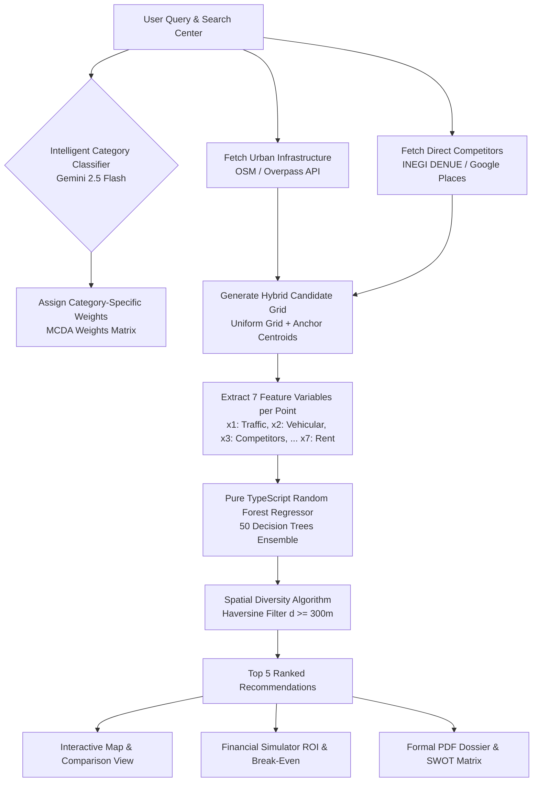

# Find Your Place 📍 — Commercial Viability Simulator & Location Intelligence

[](https://angular.dev/)
[](https://ionicframework.com/)
[](https://capacitorjs.com/)
[](https://www.typescriptlang.org/)
[](https://www.mapbox.com/)
[](https://ai.google.dev/)
[](#)

> **Find Your Place** is an intelligent mobile and web application that empowers entrepreneurs and business analysts to assess commercial location viability before investing. By combining on-device Machine Learning (pure TypeScript Random Forest), geospatial data fusion (Mapbox, OpenStreetMap, INEGI DENUE), generative AI categorization, and financial modeling, the app identifies optimal business locations, evaluates competition, predicts success probability, and generates comprehensive offline PDF feasibility reports.

---

## 📑 Table of Contents

- [Overview](#-overview)
- [Key Features](#-key-features)
- [How It Works](#-how-it-works)
  - [1. Intelligent Query Classification](#1-intelligent-query-classification)
  - [2. Geospatial Data Ingestion & Grid Sampling](#2-geospatial-data-ingestion--grid-sampling)
  - [3. Feature Extraction & Scoring Model](#3-feature-extraction--scoring-model)
  - [4. Pure TypeScript Random Forest Regressor](#4-pure-typescript-random-forest-regressor)
  - [5. Spatial Diversity Algorithm (Top 5 Ranking)](#5-spatial-diversity-algorithm-top-5-ranking)
  - [6. Financial Feasibility & PDF Dossier Generation](#6-financial-feasibility--pdf-dossier-generation)
- [Mathematical & Machine Learning Foundations](#-mathematical--machine-learning-foundations)
- [Technology Stack](#-technology-stack)
- [Project Directory Structure](#-project-directory-structure)
- [Getting Started](#-getting-started)
  - [Prerequisites](#prerequisites)
  - [Environment Configuration](#environment-configuration)
  - [Running the Development Server](#running-the-development-server)
- [Building for Android (Capacitor)](#-building-for-android-capacitor)
---

## 🌟 Overview

Choosing the right physical location is often the single most critical factor determining the success or failure of a brick-and-mortar business. Traditional market research is expensive, slow, and typically inaccessible to micro and small business owners.

**Find Your Place** democratizes commercial real estate and market intelligence by providing an all-in-one mobile solution. Users simply define an intended business type and search area; the application autonomously harvests urban infrastructure, analyzes direct competition, evaluates demographics, feeds multi-factor variables into a client-side Machine Learning model, and produces actionable recommendations with financial projections and formal analytical dossiers.

---

## 🚀 Key Features

### 🧠 Pure On-Device Random Forest Regressor
- **Zero Server Latency & 100% Offline Capable**: Machine Learning regression runs locally on the device via a custom TypeScript implementation of an ensemble decision tree regressor ($T = 50$ trees).
- **Multi-Factor Evaluation**: Analyzes 7 critical business dimensions including foot traffic, vehicular flow, competitor count, socioeconomic score, security index, population density, and estimated rent.
- **Explainable Predictions**: Computes out-of-bag (OOB) metrics, MSE, confidence intervals, and dynamic feature importance charts.

### 🗺️ Multi-Provider Geospatial Data Fusion
- **Interactive Map Experience**: Fluid vector mapping powered by **Mapbox GL JS** with custom radius picker circles (0.1 km – 5.0 km), real-time coordinates, and interactive result markers.
- **OpenStreetMap (OSM) Infrastructure Ingestion**: Extracts civic and commercial points of interest (schools, transit stops, hospitals, shopping malls, offices, arterial roads, and parking facilities).
- **Official Commercial Census (INEGI DENUE)**: Integrates Mexico's National Statistical Directory of Economic Units to pull verified competitor coordinates.
- **Reverse Geocoding with Rate Limiting**: Translates latitude/longitude coordinates into human-readable street addresses with cached OSM Nominatim queries.

### 🤖 Intelligent Semantic Search (Google Gemini AI)
- Uses **Google Gemini 2.5 Flash** to analyze natural-language search inputs (e.g., "taco stand", "barbershop", "dry cleaner").
- Filters out invalid queries and maps colloquial terms to one of 30+ standardized business categories to tune evaluation weights.

### 🎯 Spatial Diversity & Market Saturation Optimization
- **Anti-Clustering Heuristic**: Implements a Haversine distance-based spatial diversity filter ($d_{\min} \ge 300\text{m}$) ensuring the suggested **Top 5 locations** are distributed across the target area rather than tightly grouped in a single block.
- **Competition vs. Opportunity Balance**: Identifies whether a zone is *Oportunidad* (Untapped Opportunity), *Equilibrado* (Balanced), or *Saturado* (Saturated).

### 💼 Integrated Financial Simulator
- Calculates key business metrics including **Return on Investment (ROI)**, **Monthly Net Profit**, **Break-Even Point (Punto de Equilibrio)**, and **Capital Recovery Timeline (Months)** based on monthly rent, capital expenditure, operating margin, and sales forecasts.

### 📄 Automated SWOT Matrix & Native PDF Dossiers
- Generates a full analytical report featuring:
  - High-resolution Mapbox snapshot.
  - Parametric 0–100 factor breakdown.
  - Automated **SWOT Matrix (Fortalezas, Oportunidades, Debilidades, Amenazas)** customized to the chosen sector.
  - Formal final verdict (*Altamente Recomendable*, *Condicionada*, *No Viable*).
- Exports locally or shares instantly using `@capacitor/filesystem` and `@capacitor/share`.

### ⚖️ Multi-Location Comparison & Street View
- Select up to 3 candidate locations side-by-side to compare metrics in an intuitive comparison matrix.
- Integrated Google Street View panorama inspection for virtual street-level site reconnaissance.

---

## 🔄 How It Works



### 1. Intelligent Query Classification
When a user searches for an activity (e.g., *"cafetería de especialidad"*), the `IntelligentSearchService` checks local cache and submits the query to Google Gemini (`gemini-2.5-flash`). Gemini validates the query's commercial coherence and matches it to one of the application's supported industry categories (such as *Alimentos y bebidas*, *Belleza*, *Salud y Medicina*, *Educacion*, etc.). If the API is unreachable, a keyword fallback mechanism handles the classification.

### 2. Geospatial Data Ingestion & Grid Sampling
Once a search radius (e.g., 2.0 km) and center coordinates are selected:
- Overpass API extracts surrounding urban infrastructure: schools, hospitals, transit terminals, commercial hubs, parking lots, residential sectors, and principal avenues.
- INEGI's DENUE and Google Places APIs locate existing direct competitors within the designated polygon.
- A **hybrid candidate generator** constructs candidate coordinates combining a geometric spatial grid with high-density commercial centroids.

### 3. Feature Extraction & Scoring Model
For every candidate location, the engine calculates a 7-dimensional feature vector within a local influence radius ($r = 500\text{m}$):
- **$x_1$ (Foot Traffic):** Derived from proximity to transit, educational institutions, healthcare centers, and malls.
- **$x_2$ (Vehicular Flow):** Derived from main road arteries, transit intersections, and parking facilities.
- **$x_3$ (Competitor Density):** Discrete count of active competitors in the effective zone.
- **$x_4$ (Socioeconomic Indicator):** Inferred from commercial/office density, premium retail centers, and residential profiling.
- **$x_5$ (Security Index):** Derived from street illumination indicators, commercial activity, and main road visibility.
- **$x_6$ (Population Density):** Residential and commercial zone density.
- **$x_7$ (Average Rent Level):** Corporate, retail, and residential baseline rental estimates.

### 4. Pure TypeScript Random Forest Regressor
The feature vector $\mathbf{x} = [x_1, x_2, \dots, x_7]$ is evaluated by the client-side `RandomForestService`:
$$\hat{f}(\mathbf{x}) = \frac{1}{T} \sum_{t=1}^{T} h_t(\mathbf{x})$$
where $T = 50$ regression decision trees independently vote on viability (score $0.0 - 5.0$). This yields the global viability score and confidence metrics without requiring external API calls.

### 5. Spatial Diversity Algorithm (Top 5 Ranking)
To prevent all recommended points from clustering around a single corner, `selectDiverseBest()` sorts candidates by score and applies an iterative Haversine distance constraint ($d \ge 300\text{m}$):
$$d = 2R \arcsin\left(\sqrt{\sin^2\left(\frac{\Delta\phi}{2}\right) + \cos(\phi_1)\cos(\phi_2)\sin^2\left(\frac{\Delta\lambda}{2}\right)}\right)$$
This yields a **Top 5** list of spatially distributed, high-potential candidate locations.

### 6. Financial Feasibility & PDF Dossier Generation
Entrepreneurs can feed expected operational figures into the **Financial Simulator** to forecast break-even and payback periods. When ready, the user can tap **Exportar Informe** to trigger `jsPDF` and render an executive PDF report complete with Mapbox cartography, SWOT insights, score breakdowns, and recommendations, shareable directly via Android's native system dialog.

---

## 🧮 Mathematical & Machine Learning Foundations

### Random Forest Hyperparameters
```typescript
NUM_TREES = 50            // Number of decision trees (T)
MAX_DEPTH = 8             // Maximum tree depth
MIN_SAMPLES_SPLIT = 5     // Minimum samples to split a node
MAX_FEATURES_RATIO = 0.7  // Random feature subset ratio per split
BOOTSTRAP_RATIO = 0.8     // Sampling with replacement ratio
```

### Multi-Criteria Decision Analysis (MCDA) Weights
In addition to the Random Forest prediction, parametric category weights adjust priority according to industry needs:

$$\text{Score}_{\text{Legacy}} = \sum_{i} w_i \cdot s_i$$

| Business Category | Foot Traffic ($w_{\text{traffic}}$) | Competition ($w_{\text{comp}}$) | Socioeconomic ($w_{\text{socio}}$) | Accessibility ($w_{\text{access}}$) | Security ($w_{\text{sec}}$) |
| :--- | :---: | :---: | :---: | :---: | :---: |
| **Alimentos y bebidas** | 0.40 | 0.25 | 0.15 | 0.10 | 0.10 |
| **Tienda Abarrotes** | 0.45 | 0.30 | 0.05 | 0.10 | 0.10 |
| **Salud y Medicina** | 0.20 | 0.15 | 0.20 | 0.35 | 0.10 |
| **Educacion** | 0.15 | 0.15 | 0.25 | 0.20 | 0.25 |
| **Legal y Financiero** | 0.15 | 0.20 | 0.30 | 0.15 | 0.20 |
| **Servicios Vehiculares** | 0.25 | 0.25 | 0.10 | 0.30 | 0.10 |
| *Default / General* | 0.30 | 0.20 | 0.20 | 0.15 | 0.15 |

---

## 🛠️ Technology Stack

| Category | Technology | Version | Purpose |
| :--- | :--- | :--- | :--- |
| **Core Framework** | [Angular](https://angular.dev/) | `^20.0.0` | Component architecture, TypeScript routing, and reactivity |
| **Mobile UI System** | [Ionic Framework](https://ionicframework.com/) | `^8.0.0` | Mobile components, gesture navigation, and touch controls |
| **Native Runtime** | [Capacitor](https://capacitorjs.com/) | `^8.1.0` | Android compilation, native filesystem, and system share dialogs |
| **Language** | [TypeScript](https://www.typescriptlang.org/) | `~5.9.0` | Strongly typed application and machine learning logic |
| **Machine Learning** | Pure TypeScript Random Forest | Custom | In-browser/on-device ensemble regression model |
| **Cartography & Maps** | [Mapbox GL JS](https://docs.mapbox.com/mapbox-gl-js/) | `^3.20.0` | High-performance WebGL vector maps and geocoding |
| **Open Geodata** | OpenStreetMap / Overpass | REST | Infrastructure extraction (transit, schools, malls, hospitals) |
| **Commercial Census** | INEGI DENUE API | REST | Official Mexican commercial registry data |
| **Places & Street View** | Google Maps & Places API | JavaScript SDK / REST | Competitor verification and panoramic Street View previews |
| **Generative AI** | Google Gemini (`gemini-2.5-flash`) | v1beta REST | Natural language query understanding and category mapping |
| **Document Generation** | [jsPDF](https://github.com/parallax/jsPDF) & [html2canvas](https://html2canvas.hertzen.com/) | `^4.2.0` / `^1.4.1` | Client-side vector and canvas PDF compilation |
| **Icons & Assets** | [Ionicons](https://ionic.io/ionicons) | `^7.0.0` | Mobile icons and indicators |

---

## 💻 Getting Started

### Prerequisites

Ensure you have the following installed on your workstation:
- **Node.js**: `v18.x` or `v20.x` LTS ([Download](https://nodejs.org/))
- **npm**: `v9.x` or newer (included with Node)
- **Angular CLI**: `npm install -g @angular/cli@20`
- **Ionic CLI**: `npm install -g @ionic/cli`
- **Android Studio** *(for Android builds)*: Hedgehog / Iguana or later with Android SDK and JDK 17+

### Environment Configuration

Open `src/environments/environment.ts` and populate your API credentials:

```typescript
export const environment = {
  production: false,
  apiKeys: {
    mapbox: 'YOUR_MAPBOX_PUBLIC_ACCESS_TOKEN',
    googlePlaces: 'YOUR_GOOGLE_PLACES_AND_MAPS_KEY',
    tomtom: 'YOUR_TOMTOM_KEY',               // Optional
    foursquare: 'YOUR_FOURSQUARE_KEY',       // Optional
    yelp: 'YOUR_YELP_KEY',                   // Optional
    inegi: 'YOUR_INEGI_API_TOKEN',           // Required for Mexico DENUE data
    gemini: 'YOUR_GOOGLE_GEMINI_API_KEY'     // For AI semantic query categorization
  }
};
```

> 💡 **Tip:** While Mapbox and Gemini tokens unlock the full feature set, the application includes offline fallback models and synthetic data generators if an external API key is omitted.

### Running the Development Server

Launch the web version in development mode:

```bash
ionic serve
# or
npm start
```

Navigate to `http://localhost:8100/` in your browser. Open Developer Tools in mobile emulation mode (e.g., Pixel 7 or iPhone 15) for the optimal experience.

---

## 📱 Building for Android (Capacitor)

1. **Build the production web bundle:**
   ```bash
   npm run build
   ```

2. **Sync web assets with the native Android project:**
   ```bash
   npx cap sync android
   ```

3. **Open the project in Android Studio:**
   ```bash
   npx cap open android
   ```

4. **Deploy to a physical device or emulator:**
   - In Android Studio, select your target device and click **Run (Shift + F10)**.
   - Alternatively, build a debug APK via CLI:
     ```bash
     cd android
     ./gradlew assembleDebug
     ```
     The output APK will be located at `android/app/build/outputs/apk/debug/app-debug.apk`.

---